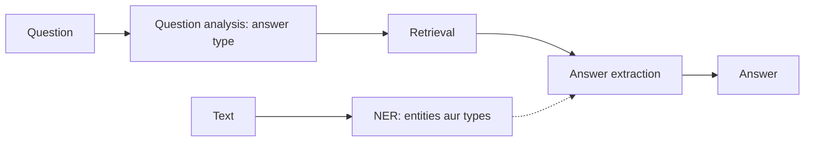

**In simple words:** NER text ke important names dhoondhkar label karta hai. QA system question ka exact fact se answer deta hai. (Question mein "Named Entity Resolution" likha hai; class answer Named Entity **Recognition** ka hai.) <Cite id="class-nlp-asol" loc="p. 8" /><Cite id="class-nlp-asol" loc="p. 10" />

**(i) Named Entity Recognition (NER).** **Definition:** Named Entity Recognition (NER) in NLP focuses on identifying and categorizing important information, known as entities, in text. Entities people, places, organizations, dates waghera ke names ho sakte hain. Ye unstructured text ko structured information banata hai, jo text summarization, knowledge graph creation aur question answering mein madad karta hai. <Cite id="class-nlp-m6" loc="slide 35" /> Example types: person (Albert Einstein), organization (GeeksforGeeks), location (Paris), date aur time (5th May 2025), quantity (50%). Context type decide karta hai: "Amazon is expanding rapidly" (organization) vs "The Amazon is the largest rainforest" (location). <Cite id="class-nlp-m6" loc="slide 36" />

*Working:* text analyze, sentence boundaries, tokenize aur POS tag, entities detect aur classify, train aur refine, naye contexts mein adapt. *Methods:* lexicon-based, rule-based, machine learning (multi-class classification, CRF) aur deep learning (BiLSTM, CNN, Transformers). <Cite id="class-nlp-m6" loc="slides 37-39" />

**(ii) Question Answering (QA) system.** QA system ek AI program hai jo human-language questions ka precise facts ya short passages se answer deta hai, documents ki lambi list nahi. Pipeline: **question analysis** (tokens, POS tags, answer type jaise person, location, date), **information retrieval** (document store, knowledge graph ya vector database se relevant passages) aur **answer extraction ya generation** (BERT ya LLM). Types: extractive, generative, open-domain aur closed-domain. <Cite id="class-nlp-m6" loc="slides 15-16" />

**Conclusion:** NER text ko structure deta hai; QA retrieval aur extraction se seedha answer deta hai.
