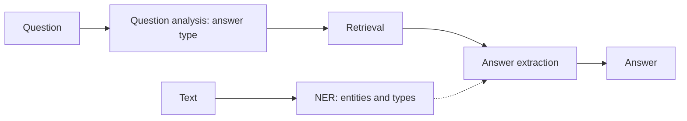

**In simple words:** NER finds and labels the important names in a text. A QA system answers a question with an exact fact. (The question writes "Named Entity Resolution"; the class answer is about Named Entity **Recognition**.) <Cite id="class-nlp-asol" loc="p. 8" /><Cite id="class-nlp-asol" loc="p. 10" />

**(i) Named Entity Recognition (NER).** **Definition:** Named Entity Recognition (NER) in NLP focuses on identifying and categorizing important information, known as entities, in text. Entities can be names of people, places, organizations, dates and so on. It turns unstructured text into structured information, which helps text summarization, knowledge graph creation and question answering. <Cite id="class-nlp-m6" loc="slide 35" /> Example types: person (Albert Einstein), organization (GeeksforGeeks), location (Paris), date and time (5th May 2025), quantity (50%). Context fixes the type: "Amazon is expanding rapidly" (organization) against "The Amazon is the largest rainforest" (location). <Cite id="class-nlp-m6" loc="slide 36" />

*Working:* analyze the text, find sentence boundaries, tokenize and POS tag, detect and classify entities, train and refine, adapt to new contexts. *Methods:* lexicon-based, rule-based, machine learning (multi-class classification, CRF) and deep learning (BiLSTM, CNN, Transformers). <Cite id="class-nlp-m6" loc="slides 37-39" />

**(ii) Question Answering (QA) system.** A QA system is an AI program that answers human-language questions with precise facts or short passages instead of a long list of documents. Pipeline: **question analysis** (tokens, POS tags, answer type such as person, location, date), **information retrieval** (relevant passages from a document store, knowledge graph or vector database) and **answer extraction or generation** (BERT or an LLM). Types: extractive, generative, open-domain and closed-domain. <Cite id="class-nlp-m6" loc="slides 15-16" />

**Conclusion:** NER structures the text; QA uses retrieval and extraction to give a direct answer.
