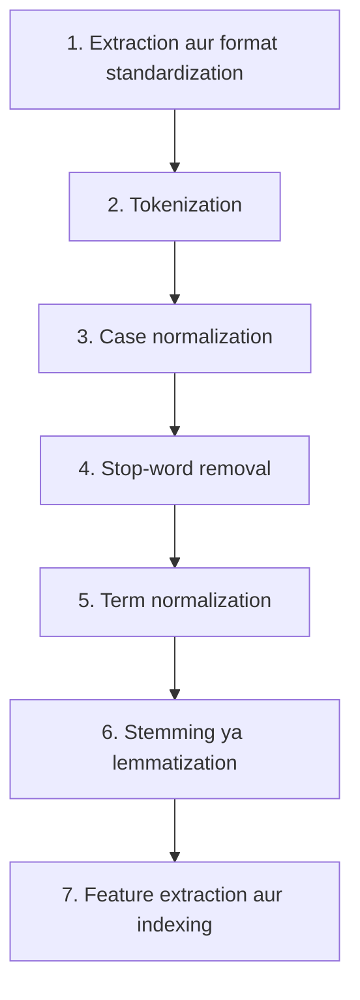

**In simple words:** search se pehle raw documents ko clean, standard form mein badalte hain taaki query ke words document ke words se jaldi match ho sakein. Result ek **inverted index** hota hai. <Cite id="class-nlp-asol" loc="p. 11" />

1. **Document text extraction and format standardization:** HTML, PDF ya DOCX se raw text nikaalo; HTML tags, metadata, control characters jaisa noise hatao; encoding ek karo (aam taur pe UTF-8).
2. **Tokenization:** text ko tokens mein todo, whitespace aur punctuation delimiters se. Mushkil cases: hyphenated words aur Chinese ya Thai jaisi languages jahan space nahi hota.
3. **Case normalization:** lowercase karo, taaki "Information", "information" aur "INFORMATION" ek term ban jaayein.
4. **Stop-word removal:** the, is, a, and, in jaise high-frequency words hatao jinka meaning kam hota hai; isse index chhota hota hai aur noise hat'ta hai. Modern systems minimal lists use karte hain, taaki "to be or not to be" jaise phrases bache rahein.
5. **Term normalization:** variations ko ek form mein mapao: punctuation aur special characters hatao, aur U.S.A., USA aur United States ko same banao.
6. **Stemming or lemmatization:** stemming rules se word ke ends kaatta hai (Porter's stemmer), isliye retrieval, retrieved, retrieving se "retriev" banta hai; lemmatization vocabulary aur morphology se dictionary form deta hai (better se good, mice se mouse).
7. **Feature extraction and indexing:** inverted index banao (har term ke saath un documents ki list jinme wo hai) aur terms ko TF-IDF ya BM25 se weight karo taaki results rank hon. <Cite id="class-nlp-asol" loc="p. 11" /><Cite id="class-nlp-asol" loc="p. 12" />

| Technique | Description | Example |
|---|---|---|
| Stemming | rules se word ke ends kaatna; fast, non-words de sakta hai | retrieval, retrieved, retrieving se "retriev" |
| Lemmatization | vocabulary aur morphology se asli dictionary form | better se good; mice se mouse |

**Conclusion:** ye saat steps wo index dete hain jisse IR system queries jaldi match karta hai aur results rank karta hai.
