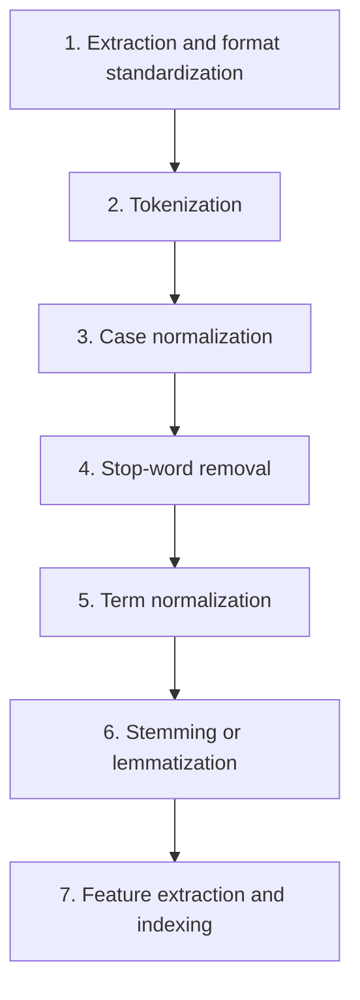

**In simple words:** before search, raw documents are turned into a clean, standard form so that the words of a query can be matched with the words of the documents quickly. The result is an **inverted index**. <Cite id="class-nlp-asol" loc="p. 11" />

1. **Document text extraction and format standardization:** extract raw text from HTML, PDF or DOCX; remove noise such as HTML tags, metadata and control characters; unify the encoding (usually UTF-8).
2. **Tokenization:** break the text into tokens, using whitespace and punctuation as delimiters. Hard cases: hyphenated words and languages like Chinese or Thai with no spaces.
3. **Case normalization:** convert to lowercase, so "Information", "information" and "INFORMATION" become one term.
4. **Stop-word removal:** drop high-frequency words (the, is, a, and, in) that carry little meaning; this shrinks the index and removes noise. Modern systems use minimal lists, to keep phrases like "to be or not to be".
5. **Term normalization:** map variations to one form: remove punctuation and special characters, and make U.S.A., USA and United States the same.
6. **Stemming or lemmatization:** stemming chops word ends by rules (Porter's stemmer), so retrieval, retrieved and retrieving become "retriev"; lemmatization uses vocabulary and morphology to give the dictionary form (better becomes good, mice becomes mouse).
7. **Feature extraction and indexing:** build an inverted index (each term maps to the documents containing it) and weight terms by TF-IDF or BM25 to rank results. <Cite id="class-nlp-asol" loc="p. 11" /><Cite id="class-nlp-asol" loc="p. 12" />

| Technique | Description | Example |
|---|---|---|
| Stemming | crude rule-based chopping of word ends; fast, may give non-words | retrieval, retrieved, retrieving to "retriev" |
| Lemmatization | uses vocabulary and morphology to give the real dictionary form | better to good; mice to mouse |

**Conclusion:** these seven steps give the index that lets an IR system match queries fast and rank results.
